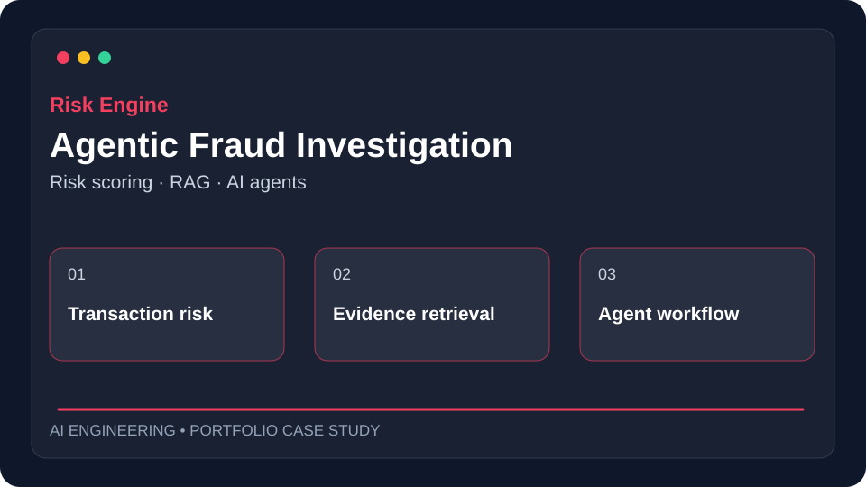
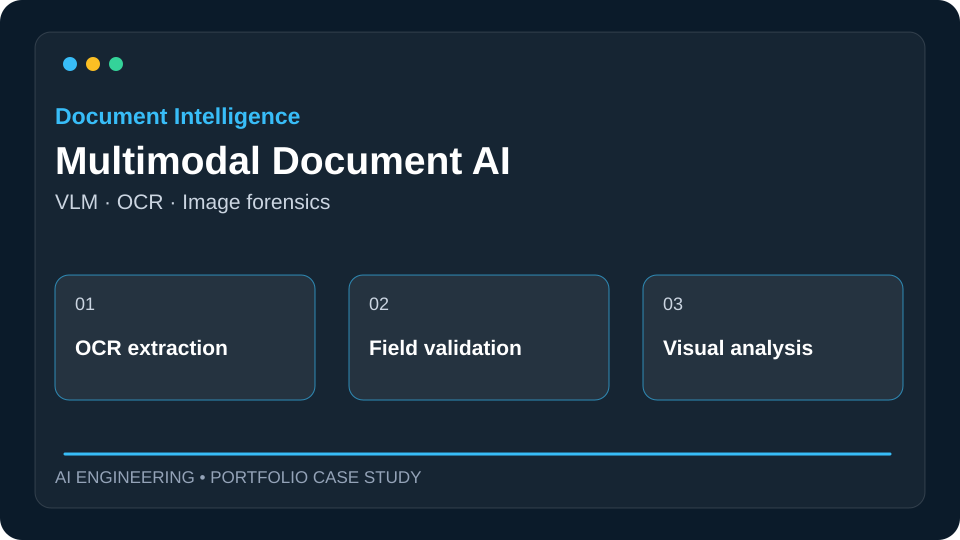
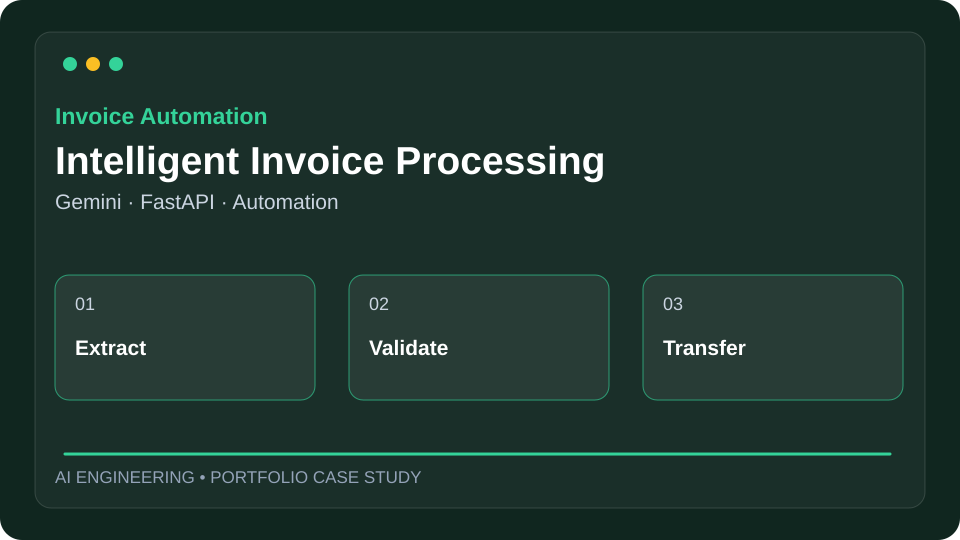
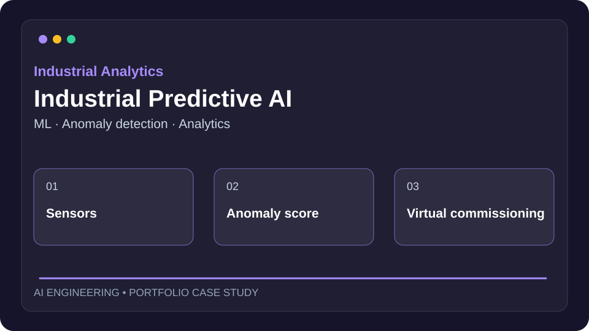

# Sakthi Nandhan
### AI Engineer | Agentic AI & Multimodal Systems

**Production AI Systems · Computer Vision · AI Architecture**

Building AI-powered solutions for financial services, document intelligence, industrial analytics, and enterprise automation.

[Featured Projects](#-featured-projects) · [Skills](#-technical-stack) · [Project Readiness](#-project-readiness-checklist) · [Contact](#-connect)

---

## 🚀 Featured Projects

<table>
<tr>
<td width="50%" valign="top">

<h3>Agentic Fraud Investigation</h3>

<strong>AI Agents · RAG · Risk Analysis</strong>

Transaction risk scoring, evidence retrieval, and structured investigation workflows with LangGraph, FastAPI, PostgreSQL, and Milvus.

Case study in preparation · Concept illustration
</td>
<td width="50%" valign="top">

<h3>Multimodal Document AI</h3>

<strong>VLM · OCR · Image Forensics</strong>

Document understanding and suspicious-edit analysis for invoices, payslips, and identity documents using OCR and vision-language models.

Case study in preparation · Concept illustration
</td>
</tr>
<tr>
<td width="50%" valign="top">

<h3>Intelligent Invoice Processing</h3>

<strong>Gemini · FastAPI · Automation</strong>

AI-assisted invoice extraction, normalization, customer enrichment, validation, and API-based workflow integration.

Case study in preparation · Concept illustration
</td>
<td width="50%" valign="top">

<h3>Industrial Predictive AI</h3>

<strong>ML · Anomaly Detection · Analytics</strong>

Industrial analytics, anomaly detection, simulation, and virtual commissioning concepts for operational intelligence.

Case study in preparation · Concept illustration
</td>
</tr>
</table>

> Illustrations represent portfolio concepts, not screenshots of deployed applications. Some project implementations are private; public case studies will use permission-cleared details and synthetic data.

## 🧰 Technical Stack

| Area | Technologies |
| --- | --- |
| **AI Agents & GenAI** | LangGraph, LLMs, RAG, tool orchestration, structured outputs |
| **Multimodal AI** | OCR, vision-language models, OpenCV, document analysis |
| **ML & Data Science** | Python, scikit-learn, PyTorch, JAX, SQL |
| **Backend & Data** | FastAPI, PostgreSQL, Redis, RabbitMQ, Milvus |
| **Infrastructure** | Docker, Linux, Kubernetes, Azure, GitHub Actions |
| **Monitoring** | Prometheus, Grafana, application observability |

## 📋 Project Readiness Checklist

Every featured project is being prepared to include the following evidence. **Unchecked means not yet verified for the public portfolio**, not necessarily missing from the underlying private project.

- [ ] Clear business problem and solution
- [ ] System architecture diagram
- [ ] Technology stack and engineering decisions
- [ ] Installation and Docker setup
- [ ] Sample API requests and responses
- [ ] Screenshots or demonstration video
- [ ] Tests, evaluation metrics, and limitations
- [ ] Security considerations and sanitized sample data
- [ ] GitHub Actions CI workflow

## 💻 Explore Public Code

| Repository | Description |
| --- | --- |
| [AI_Learn](https://github.com/sakthinandhan95-svg/AI_Learn) | AI experiments and learning notebooks |
| [build-an-mlp-in-jax-from-scratch](https://github.com/sakthinandhan95-svg/build-an-mlp-in-jax-from-scratch) | Building a neural network with JAX |
| [Bank-Fraud-Detection](https://github.com/sakthinandhan95-svg/Bank-Fraud-Detection) | Forked reference project for fraud detection learning |

## 🔍 Engineering Approach

**Design → Build → Validate → Deploy → Monitor**

I focus on modular AI services, reproducible evaluation, secure data handling, well-defined APIs, observability, and clear architecture documentation.

---

### 🤝 Connect

[GitHub](https://github.com/sakthinandhan95-svg) · [Repositories](https://github.com/sakthinandhan95-svg?tab=repositories)

AI Engineering · Agentic AI · Multimodal Systems · AI Architecture

